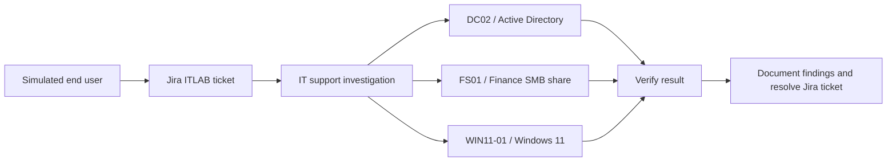
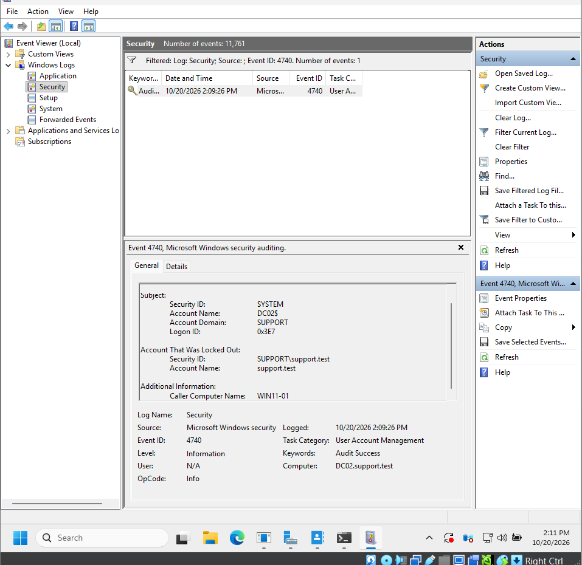
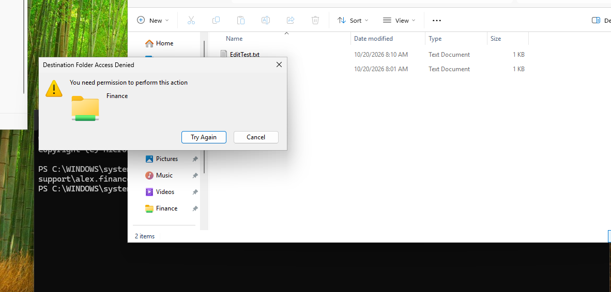
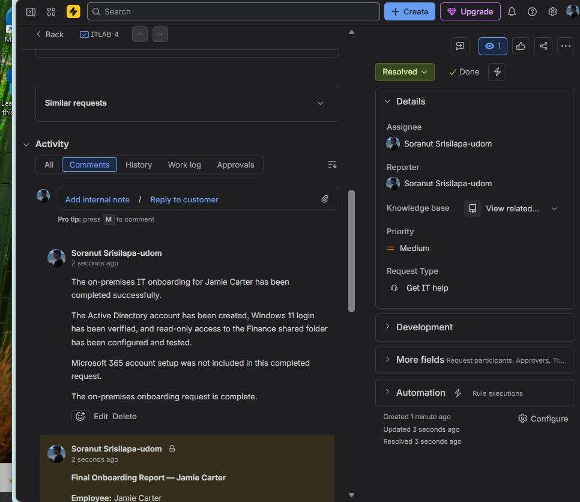

# Windows IT Support & Service Desk Lab

**Jira Service Management | Windows Server 2025 | Active Directory | Windows 11 | File Sharing | Troubleshooting**

A hands-on **simulated IT support environment** documenting four completed service desk scenarios, from ticket creation and investigation to tested resolution. This project demonstrates practical Windows administration, account recovery, Active Directory access management, SMB/NTFS troubleshooting, and technician documentation.

> **Scope:** Four Jira scenarios are complete. Microsoft 365 cloud onboarding was **not** completed for the Jamie Carter scenario because the earlier trial may have expired. No production infrastructure or real employee accounts were used.

## Project documents

- [Professional project report (PDF)](docs/IT_Support_Lab_Professional_Report.pdf) — portfolio-style summary, outcomes, architecture and screenshots.
- [Beginner technical walkthrough (PDF)](docs/IT_Support_Lab_Step_by_Step_Walkthrough.pdf) — GUI steps, commands, investigation procedures and evidence checkpoints.
- [Evidence screenshots](evidence/) — a selected set of screenshots captured during the lab.

## Environment

| Component | Role |
|---|---|
| **DC02** | Windows Server 2025 Desktop Experience; Active Directory Domain Services, password policy and Security logs |
| **FS01** | Windows file server hosting `\\FS01\Finance` |
| **WIN11-01** | Windows 11 Enterprise domain-joined test workstation |
| **support.test** | Test Active Directory domain |
| **Jira Service Management (ITLAB)** | Ticket lifecycle, assignment, internal notes, customer replies and resolutions |

### Lab workflow



*Diagram describes the functional lab workflow, not a verified network topology.*

## Completed scenarios

| Jira ticket | Reported issue | Root cause / action | Verification |
|---|---|---|---|
| **ITLAB-1** | Windows 11 sign-in blocked | `nicky.support` was disabled in AD; account re-enabled | AD `Enabled=True`; Windows 11 identity verified; Jira resolved |
| **ITLAB-2** | Domain account locked after failed sign-ins | A test-only fine-grained password policy with a five-attempt threshold triggered lockout | `LockedOut=True`, `BadPwdCount=5`; Security Event **4740** identified `WIN11-01`; access later restored |
| **ITLAB-3** | Finance shared folder access denied | `alex.finance` lacked `Finance.read` group membership; read access granted for the approved lab scenario | `\\FS01\Finance` accessible; files readable; file creation denied |
| **ITLAB-4** | Onboard fictional Finance employee Jamie Carter | Created `jamie.carter`, added `Finance.read`, tested domain sign-in | `whoami` verified identity; Finance documents readable; file creation denied; Jira resolved |

### Selected visual evidence

**ITLAB-2 — Account lockout and Security Event 4740**



**ITLAB-3 — Read-only folder enforcement**



**ITLAB-4 — Completed Jira onboarding ticket**



Additional screenshots are available in the [`evidence/`](evidence/) folder and the two PDF documents.

## Key technical checks

Commands below are for reference and demonstration. They should be run only in an authorized test domain. The walkthrough distinguishes observed commands from optional alternatives.

```powershell
# Account state and failed sign-in counter
Get-ADUser -Identity "support.test" -Properties Enabled,LockedOut,BadPwdCount |
  Select-Object Name,Enabled,LockedOut,BadPwdCount

# Effective fine-grained password policy for the test user
Get-ADUserResultantPasswordPolicy -Identity "support.test" |
  Select-Object Name,LockoutThreshold,LockoutDuration,LockoutObservationWindow

# Membership for an onboarded Finance employee
Get-ADPrincipalGroupMembership "jamie.carter" | Select-Object Name

# Confirm Windows identity on WIN11-01
whoami
```

## Security principles demonstrated

- **Least privilege:** Finance users requiring viewing access were assigned `Finance.read`, not `Finance.modify` or administrator groups.
- **Layered permissions:** Both SMB share permissions and NTFS permissions were reviewed.
- **Evidence-based troubleshooting:** AD account state, failed sign-in counters, Event ID 4740 and actual Windows 11 behavior were correlated.
- **ITIL-style ticket documentation:** Each scenario included an investigation note, user communication, and recorded resolution in Jira.
- **Test-only configuration:** The lockout policy was scoped to a designated lab account rather than changing the whole domain's default account lockout threshold.

## Scope and limitations

- This is a controlled educational lab, **not** a production deployment.
- The exact mechanism by which the ITLAB-2 account became unlocked (manual vs. automatic) was not established from the captured evidence. No password reset was demonstrated.
- Microsoft 365 cloud account provisioning for ITLAB-4 was excluded and is not presented as completed.
- Some temporary file-access behavior was observed during ITLAB-3; the final screenshots show successful file reads and correctly denied file creation.

## Repository structure

```text
windows-it-support-service-desk-lab/
├── README.md
├── docs/
│   ├── IT_Support_Lab_Professional_Report.pdf
│   ├── IT_Support_Lab_Step_by_Step_Walkthrough.pdf
│   └── PUBLICATION_CHECKLIST.md
└── evidence/
    ├── itlab-1-*.png
    ├── itlab-2-*.png
    ├── itlab-3-*.png
    └── itlab-4-*.png
```

## Publication note

The included screenshots and report mention lab user names, the `support.test` domain, and the Jira profile name. **Review these files for any information you do not want public** before publishing the repository. No passwords, tokens, certificates, or private keys should be uploaded.

---

**Project:** Windows IT Support & Service Desk Lab  
**Completed:** October 2026  
**Author:** Soranut Srisilapa-udom
